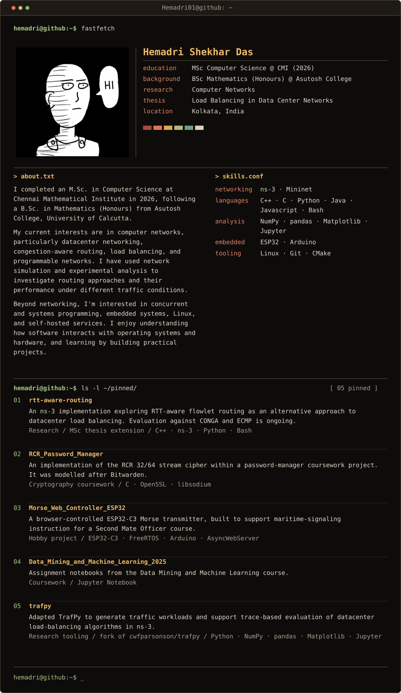

<!-- Hand-edited. Regenerating with `python3 -m src.build` overwrites this file, so port these changes into data/profile.json / config/readme.json first. -->

<samp><b>Contact / elsewhere</b> 
<a href="https://github.com/Hemadri01">[ GitHub ]</a></samp>

<samp><b>Repository links</b> 
<a href="https://github.com/Hemadri01/rtt-aware-routing">01 rtt-aware-routing</a> · <a href="https://github.com/Hemadri01/RCR_Password_Manager">02 RCR_Password_Manager</a> · <a href="https://github.com/Hemadri01/Morse_Web_Controller_ESP32">03 Morse_Web_Controller_ESP32</a> · <a href="https://github.com/Hemadri01/Data_Mining_and_Machine_Learning_2025">04 Data_Mining_and_Machine_Learning_2025</a> · <a href="https://github.com/Hemadri01/trafpy">05 trafpy</a></samp>

<samp>Full text version and project details</samp>

<pre><b>hemadri@github:~$ fastfetch</b>

<a href="https://github.com/Hemadri01">Hemadri Shekhar Das</a>
-------------------

degree      MSc Computer Science @ Chennai Mathematical Institute (Aug 2024 – Jul 2026)
undergrad   BSc Mathematics (Honours) @ Asutosh College, Univ. of Calcutta (2020 – 2024)
research    datacenter networking: load balancing and approximate congestion signals
thesis      Load Balancing in Data Center Networks (CONGA, Power of Two Choices)
now         evaluating RTT-aware flowlet routing in ns-3.48
languages   C++ · C · Python · Bash
location    Chennai, India

🟥 🟧 🟨 🟩 🟦 🟪

<b>hemadri@github:~$ cat about.txt</b>

I study how datacenter networks spread traffic across paths. I finished my MSc in Computer
Science at Chennai Mathematical Institute in July 2026, after a BSc in Mathematics
(Honours) at Asutosh College, University of Calcutta.

My thesis started from CONGA, the congestion-aware load balancer for leaf-spine fabrics.
I implemented it in ns-3, compared it with ECMP as a sanity check against the CONGA paper,
then tried to improve it by adding Power of Two Choices to its path selection. That did
not beat CONGA. Near the end I proposed a different idea: use smoothed
RTT as an approximate congestion signal, aiming for CONGA-like performance without CONGA's
custom switch hardware.

Since then I have turned that idea into a working ns-3.48 module and a validated
evaluation pipeline. In my 10 Gb/s baseline runs, CONGA clearly beats per-flow ECMP; on a
fabric with one 5 Gb/s uplink at 0.7 load, mean large-flow completion time drops from
796.5 ms to 337.2 ms. The RTT policies are only evaluated at loads 0.1 – 0.3 so far
(each 10 Gb/s run takes over 24 hours on my laptop), so I am not claiming a win yet.

Outside research I build embedded projects (an ESP32 Morse transmitter for my father's
marine training institute) and run a home lab: self-hosting, Docker, Proxmox, NAS.

<b>hemadri@github:~$ cat skills.conf</b>

languages    C++ · C · Python · Bash
simulation   ns-3.48 · leaf-spine topologies · trace replay · TCP/IPv4
networking   CONGA · ECMP · flowlet routing · RTT estimation (EWMA)
analysis     NumPy · pandas · Matplotlib · Jupyter · mean and p99 FCT analysis
validation   per-flow payload accounting · ns-3 TCP regression suites · seeded traces
embedded     ESP32-C3 · FreeRTOS · Arduino · AsyncWebServer
crypto       OpenSSL · libsodium · PBKDF2 · Argon2id · HKDF · HMAC
tooling      Linux · Git · CMake
familiarity  Java · JavaScript · HTML · CSS · LaTeX
spoken       Bengali (native) · Hindi (fluent) · English (fluent)

<b>hemadri@github:~$ cat coursework.txt</b>

networking   Networking Fundamentals · Advanced Networking Fundamentals
algorithms   Graduate Algorithms · Randomized Algorithms · Theory of Computation
systems      Introduction to Concurrent Programming · Advanced Concurrent Programming
security     Cryptography · Cryptographic Standards and Cryptanalysis
learning     Data Mining and Machine Learning · Advanced Machine Learning
mathematics  Real Analysis · Group and Ring Theory · Linear Algebra · Probability and
             Statistics · Linear Programming and Game Theory · Numerical Methods

<b>hemadri@github:~$ cat research/interests.txt</b>

  - Datacenter load balancing: flowlet switching, CONGA, and where ECMP breaks down
    under asymmetry
  - Approximate congestion signals: how coarse can RTT, ECN, or telemetry be and still
    route well
  - Transport-independent path measurement for RoCEv2 (INT, IOAM, PINT-style telemetry)
  - Reproducible simulation: shared traces, recorded seeds, payload checks, and honest
    flow completion time comparisons

<b>hemadri@github:~$ cat pinned/projects.txt</b>

[01] <a href="https://github.com/Hemadri01/rtt-aware-routing">rtt-aware-routing</a>
     type   Research / MSc thesis extension (May 2025 – ongoing)
     stack  C++ · ns-3.48 · Python · Bash
     about  Can an approximate delay estimate be enough to make useful load-balancing
            decisions? A flowlet routing module that places traffic using smoothed RTT,
            evaluated against CONGA and ECMP.
     work   - Source leaves keep an EWMA RTT estimate per uplink (alpha = 0.125), fed by
              timestamp tags that return on ACKs. Policies: RTT-weighted selection,
              Random-Two, Top-Two, lowest-RTT; fixed 500 us or RTT-derived flowlet
              timeouts.
            - Leaf-spine testbed: 2 leaves, 2 spines, 4 hosts per leaf, 10 Gb/s links,
              2:1 oversubscription, plus an asymmetric case with one 5 Gb/s uplink.
              Data-mining and enterprise workloads from the CONGA paper's flow-size CDFs;
              every algorithm replays the same trace.
            - Baselines (enterprise workload, 32 runs): every payload delivered exactly.
              At 0.7 load on the asymmetric fabric, CONGA cuts mean large-flow FCT from
              796.5 ms to 337.2 ms and p99 from 6.81 s to 2.53 s versus per-flow ECMP.
            - RTT results so far (loads 0.1 – 0.3): CONGA has the lowest overall mean FCT
              in five of six cases; RTT Random-Two edges it at asymmetric 0.2 (1.66 ms vs
              1.77 ms). Higher loads and repeated seeds are still pending.
            - Validation work: fixed a 32-bit timestamp overflow (~2.1 s) in the RTT tag,
              TCP SACK and close-time crashes, and CONGA hashing and capacity bugs; the
              43 ns-3 TCP test suites pass.
            - Decided not to publish this version: it depends on TCP timestamps, which
              RoCEv2 traffic lacks. The repo outlines a transport-independent extension.

[02] <a href="https://github.com/Hemadri01/RCR_Password_Manager">RCR_Password_Manager</a>
     type   Cryptography coursework
     stack  C · OpenSSL · libsodium
     about  An implementation of the RCR 32/64 stream cipher within a password-manager
            coursework project.
     work   - Implements cipher state, key/IV setup, and 32-bit and 64-bit keystream
              generation.
            - Supports PBKDF2-HMAC-SHA256 and Argon2id for password-based key
              derivation, followed by HKDF-SHA256 for separate key material.
            - Processes file encryption and decryption in chunks, with HMAC-SHA256
              authentication and tag comparison.

[03] <a href="https://github.com/Hemadri01/Morse_Web_Controller_ESP32">Morse_Web_Controller_ESP32</a>
     type   Independent hardware project (Sep 2023 – Jan 2024)
     stack  ESP32-C3 · FreeRTOS · Arduino · AsyncWebServer
     about  An ESP32-C3 that runs as a Wi-Fi access point and flashes a 220 V AC bulb in
            Morse code through a solid-state relay, controlled from a browser.
     work   - Web UI with a login, adjustable transmission speed, and start, stop, pause,
              and resume.
            - FreeRTOS tasks separate Morse generation, relay control, and Wi-Fi.
            - Two output stages: a test run, then the main transmission with a stopwatch
              and highlighting of the character currently being sent.
            - Built to help my father teach Morse signaling for the Second Mate Officer
              course at his marine training institute. The public repo has a subset.

[04] <a href="https://github.com/Hemadri01/Data_Mining_and_Machine_Learning_2025">Data_Mining_and_Machine_Learning_2025</a>
     type   Coursework (CMI, Jan – Apr 2025)
     stack  Jupyter Notebook
     about  Assignment notebooks from the Data Mining and Machine Learning course.

[05] <a href="https://github.com/Hemadri01/trafpy">trafpy</a>
     type   Research tooling / fork of cwfparsonson/trafpy
     stack  Python · NumPy · pandas · Matplotlib · Jupyter
     about  A TrafPy fork adapted for my datacenter routing experiments, with
            workload-generation and comparison notebooks.
     work   - Generated the benchmark traffic for my early 100 Mb/s experiments
              (private-enterprise, commercial-cloud, university, social-media-cloud),
              with rack-aware and cross-rack configurations and CSV traces for ns-3.
            - Analysis notebooks match input and output flows, compare CONGA, ECMP, and
              RTT policies, and separate small and large flow completion times.
            - Local changes remove mandatory GPU initialization from selected paths and
              adapt the nxviz plotting calls. The original generator and benchmark
              models are credited to TrafPy. My later 10 Gb/s data-mining and enterprise
              traces use a separate generator.

<b>hemadri@github:~$ cat links.conf</b>

github     <a href="https://github.com/Hemadri01">https://github.com/Hemadri01</a>

<b>hemadri@github:~$ _</b></pre>

